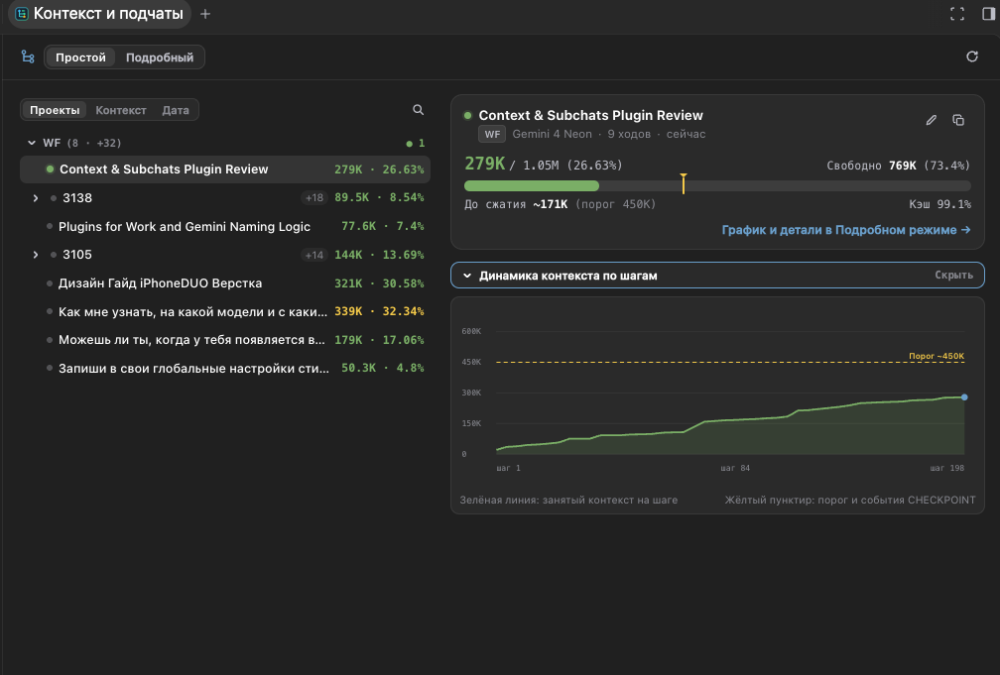
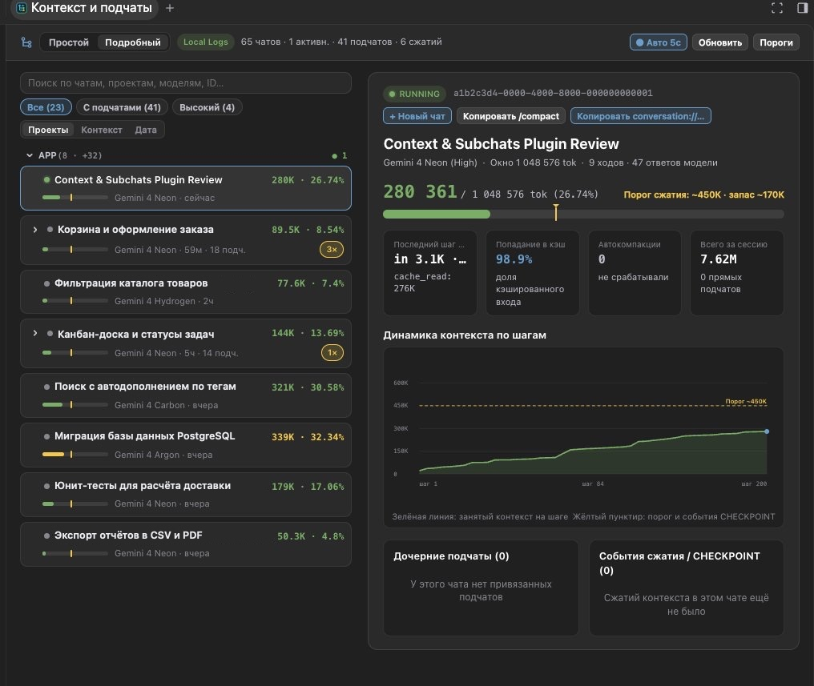

# Context & Subchats — плагин для Antigravity

<p align="center">
  
</p>

Локальный плагин (**MCP App**) для десктопного **Google Antigravity**, который закрывает две главные нехватки интерфейса:
1. **Живой монитор контекста (токенов)** — занятый объём, свободный остаток окна модели, запас до порога автосжатия, % попадания в кэш, события автокомпакции (`CHECKPOINT`) и график роста контекста по шагам.
2. **Дерево чатов и подчатов** — иерархия «родительский чат → подчаты субагентов» с группировкой по **проектам**, **величине контекста** и **дате**, со сворачиваемыми категориями.

Работает полностью локально из `~/.gemini/antigravity/brain/*/transcript.jsonl` (без сторонних серверов и телеметрии), поддерживает светлую и тёмную тему Antigravity и **не требует `npm install` при установке** — сервер и UI уже собраны в автономные бандлы (`dist/server.mjs` и `dist/app.html`).

---

## Скриншоты

### Простой режим (по умолчанию) — активный чат, запас до сжатия и график по шагам


### Подробный режим — 2-колоночный дашборд, KPI, фильтры и настройки порогов


---

## Возможности

- **Две точки входа в Antigravity:**
  - **Боковая шторка (`aux_pane`)** рядом с чатом — при открытии из конкретного чата автоматически выбирает именно его (`antigravity.google/conversation_id`).
  - **Полная страница (`global`)** из левого сайдбара — просторный 2-колоночный дашборд.
- **Два режима интерфейса** (переключатель `Простой | Подробный` в шапке):
  - **Простой:** минималистичная карточка текущего чата (занятый контекст, свободное окно, запас до сжатия, кэш), кнопка раскрытия графика «Динамика контекста по шагам» и компактное дерево чатов.
  - **Подробный:** разбивка последнего шага (`input` / `cache_read` / `output`), журнал событий сжатия `CHECKPOINT`, настройка порогов предупреждения (адаптивный `450K / 135K`, фиксированный в `K` или `%` от окна), фильтры, кнопки `+ Новый чат` и копирование `/compact`.
- **Дерево подчатов и поддержка роя (`/swarm`):**
  - Плоская привязка воркеров `/swarm` напрямую к координатору с реальными именами роя (`pencil-fix`, `verifier`, `monitor` и т. д.) вместо цепочек безымянных чатов.
  - Двойной слой метрик для чатов с подчатами: собственный контекст родителя + плашка всей ветки (`Σ` суммарный контекст, пиковый подчат с переходом в 1 клик, подсветка перегрева и активности воркеров прямо на строке родителя в дереве).
- **Умная группировка и сворачивание:**
  - `Проекты` (сворачиваемые категории проектов, состояние сохраняется)
  - `Контекст` (от самых тяжёлых чатов и веток к лёгким)
  - `Дата` (`Сегодня`, `Вчера`, `Последние 7 дней`, `Ранее`)
- **Проверка обновлений с GitHub:** раз в 12 часов сверяет версию `plugin.json` с репозиторием и показывает зелёную пилюлю `↑ vX.Y.Z` в шапке при выходе новой версии (плюс ручная проверка и копирование команды `git pull`).
- **Локальное переименование чатов (`✎`)** и сохранение всех настроек в `${PLUGIN_DATA}` (без `localStorage`).
- **Нативная интеграция:** строгий CSP (`default-src 'none'`), CSS-переменные хоста, фоновое автообновление только при видимой вкладке.

---

## Установка (за 10 секунд)

**Требования:** macOS или Linux, установленный **Node.js 18+** и **Antigravity Desktop**.

### Вариант 1: Клонирование напрямую в папку плагинов (рекомендуется)

```bash
git clone https://github.com/LebedevLC/antigravity-context-tree.git ~/.gemini/config/plugins/context-tree
```

Antigravity автоматически обнаружит плагин **без перезапуска**.

### Вариант 2: Через `agy plugin install`

```bash
git clone https://github.com/LebedevLC/antigravity-context-tree.git
agy plugin install ./antigravity-context-tree
```

### Обновление плагина

```bash
cd ~/.gemini/config/plugins/context-tree && git pull
```

После `git pull` достаточно закрыть и снова открыть вкладку **«Контекст и подчаты»** (или перезапустить сервер `context-tree_monitor` в настройках MCP).

---

## Как открыть панель

1. **Боковая шторка (`aux_pane`):** нажмите **`+`** в правой панели чата → **`Plugins`** → **«Контекст и подчаты»**.
2. **Полная страница (`global`):** откройте пункт **«Контекст и подчаты»** в левом сайдбаре (под `Customizations`).
3. **Из чата:** попросите агента *«Открой монитор контекста»* — панель откроется сразу на текущем чате.

---

## Синхронизация точных названий чатов из сайдбара (опционально)

По умолчанию процесс MCP-сервера работает в режиме **`Local Logs`**: названия чатов берутся из первого сообщения, а проект — из путей в транскрипте.

Если хочется видеть **точные короткие названия из левого сайдбара Antigravity**, выполните один раз команду из встроенного терминала Antigravity (или попросите агента выполнить её):

```bash
node ~/.gemini/config/plugins/context-tree/scripts/sync-titles.mjs
```

Скрипт использует документированный локальный `ConversationService` (`ListConversations` / `GetConversation`) и сохраняет заголовки локально в `~/.gemini/antigravity/plugin_data/context-tree/titles-cache.json`. Любой чат также можно переименовать вручную кнопкой `✎` прямо в интерфейсе панели.

---

## Разработка и сборка из исходников

```bash
npm install
npm run build        # пересобирает dist/app.html и dist/server.mjs
npm run test:smoke   # прогоняет stdio smoke-тест MCP-сервера
agy plugin validate . --strict
```

### Структура репозитория

```text
├── plugin.json             # манифест плагина Antigravity
├── mcp_config.json         # конфигурация MCP-сервера
├── bin/start-server.sh     # кросс-машинный лаунчер Node.js (PATH / Homebrew / nvm)
├── dist/
│   ├── server.mjs          # автономный бандл MCP-сервера (без node_modules)
│   └── app.html            # однофайловый UI на @modelcontextprotocol/ext-apps
├── server/                 # исходники MCP-сервера и потокового парсера транскриптов
├── ui/                     # исходники интерфейса (HTML / CSS / JS)
├── scripts/                # сборка, smoke-тесты и синхронизация названий
├── assets/logo.svg         # иконка плагина
└── docs/screenshots/       # скриншоты для README
```

---

## См. также

- **[Usage & Limits (`antigravity-usage-limits`)](https://github.com/LebedevLC/antigravity-usage-limits)** — второй плагин из серии: реальные 5-часовые и недельные лимиты через `agy CLI`, графики квот, пересчёт в API USD и тепловые карты активности.

---

## Лицензия

[MIT](LICENSE)
